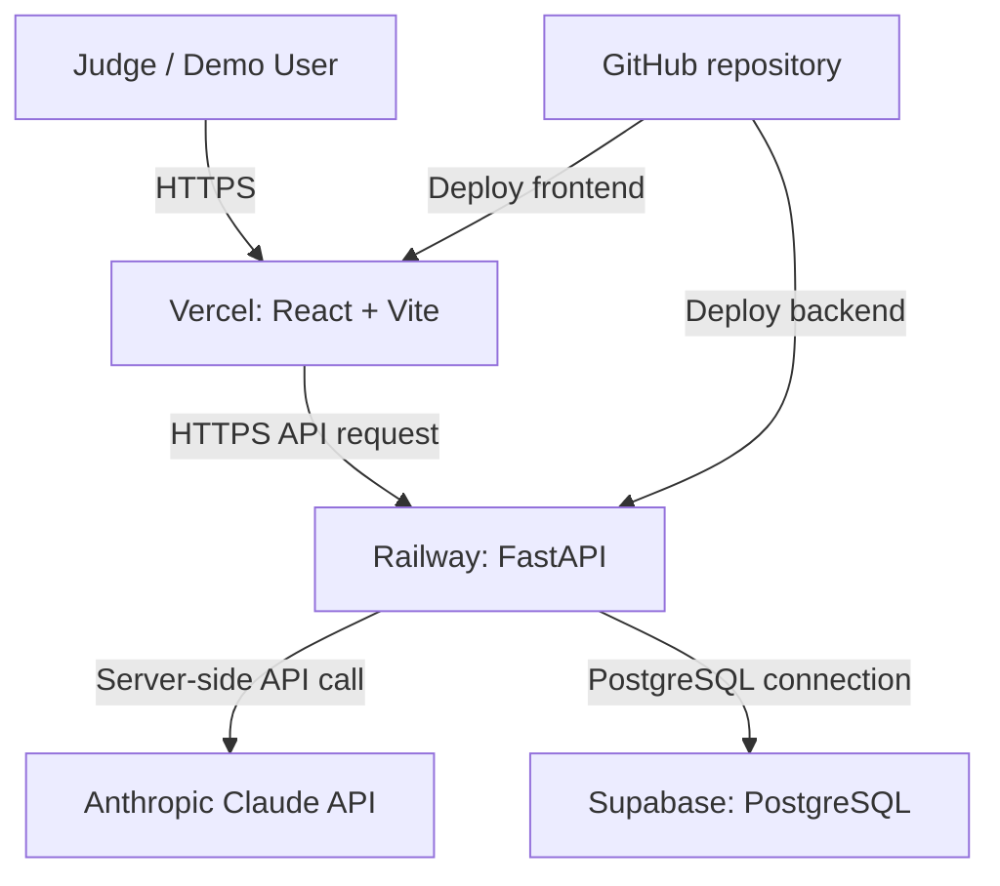

# TraceCare — Public MVP Deployment Guide

**Goal:** make the TraceCare hackathon MVP accessible to judges through a public HTTPS URL.

**Recommended setup:** Vercel (React frontend) + Railway (FastAPI backend) + Supabase (PostgreSQL database) + Anthropic (server-side LLM API).

This guide is for a synthetic-data demo only. Do not use real patient records, real personal identifiers, or real consultations.

---

## 1. Recommended architecture



Responsibilities:

- **Vercel:** serves the React application and provides the public frontend URL.
- **Railway:** runs the Python FastAPI application and exposes the API URL.
- **Supabase:** stores demo encounter data in managed PostgreSQL. It does not replace FastAPI business logic.
- **Anthropic:** processes structured extraction / patient-language generation when the Claude provider is enabled. Calls happen only from FastAPI.
- **GitHub:** holds the source code and triggers deployments when changes are pushed.

### Why this arrangement?

It preserves the project's current React + FastAPI stack and gives each component a clear role. Railway has a documented FastAPI deployment path. Supabase provides managed PostgreSQL and lets you select the database region. Vercel is well suited to serving the Vite frontend.

Official references:

- [Vercel monorepos and root directories](https://vercel.com/docs/monorepos)
- [Railway FastAPI deployment guide](https://railway.com/guides/fastapi)
- [Supabase PostgreSQL overview](https://supabase.com/docs/guides/database/overview)
- [Supabase region and data residency FAQ](https://supabase.com/legal/privacy-resources/data-residency-transfers-faq)

---

## 2. Hosting choices and alternatives

| Setup | When to choose it | Watch-outs |
|---|---|---|
| **Vercel + Railway + Supabase** | Recommended default for current React + FastAPI app | Railway is usage-based. Check current trial/plan terms and whether the service will sleep after inactivity. |
| **Vercel + Render + Supabase** | Choose if you prefer Render's straightforward Python web-service setup | Render Free web services sleep after 15 minutes idle and can take about a minute to wake. Use a paid always-on option if cold starts are unacceptable during judging. |
| **Vercel frontend + Vercel Python/FastAPI + Supabase** | Choose if you want to keep hosting mostly within Vercel | Vercel's Python runtime is documented as Beta; function-duration limits apply. Test the complete Claude request before committing to this choice. |
| **Render frontend + Render backend + Supabase** | Choose if you prefer one dashboard for frontend and API | The free backend sleep behaviour still applies. |

Current platform details can change. As checked for this documentation:

- Vercel documents its Python runtime as Beta and supports Python frameworks including FastAPI. Its Functions limits page lists a 300-second maximum for Hobby with Fluid Compute. See [Python runtime](https://vercel.com/docs/functions/runtimes/python) and [function limitations](https://vercel.com/docs/functions/limitations).
- Render says Free web services spin down after 15 minutes of inactivity; waking can take about a minute, and the local filesystem is ephemeral. See [Render Free](https://render.com/docs/free).
- Railway's current Free plan includes $1 of monthly usage and services sleep after 5–10 minutes of outbound inactivity. New accounts may receive a one-time $5, 30-day trial grant. Check [Railway Free Plan](https://docs.railway.com/pricing/free-plan) and [Railway Plans](https://docs.railway.com/pricing/plans).

**Practical recommendation:** use Railway during the hackathon if the team's account has enough trial/usage budget and outbound access to Anthropic. If you need to avoid usage-based backend hosting, try Vercel's FastAPI runtime only after validating that the current project deploys and the complete analysis request stays within its function limits. Render Free is acceptable for a low-cost test URL, but the cold start can interrupt a live demo.

---

## 3. Prerequisites

Create / connect these accounts before the event if permitted by the hackathon rules:

1. GitHub repository containing TraceCare.
2. Vercel account connected to GitHub.
3. Railway account connected to GitHub (or Render, if chosen).
4. Supabase account.
5. Anthropic API access if live Claude analysis is required.

The Claude Code subscription / credit and Anthropic API billing are separate concepts. Verify API key access and billing in Anthropic Console. Keep the deterministic demo provider available so the app can still be shown if API access fails.

---

## 4. Prepare the repository for deployment

Expected structure:

```text
tracecare/
├── frontend/
│   ├── package.json
│   ├── .env.example
│   └── src/
├── backend/
│   ├── app/main.py
│   ├── requirements.txt
│   └── .env.example
├── supabase/
│   └── migrations/
│       └── 001_initial_schema.sql
└── docs/
    └── DEPLOYMENT_GUIDE.md
```

Required configuration:

- Frontend reads the backend URL from `VITE_API_BASE_URL`.
- Backend reads `ANTHROPIC_API_KEY`, `ANTHROPIC_MODEL`, `DATABASE_URL`, and `CORS_ORIGINS` from its environment.
- Local development may use SQLite via `DATABASE_URL=sqlite:///./tracecare.db`.
- Hosted deployment uses Supabase PostgreSQL via a PostgreSQL `DATABASE_URL`.
- Do not rely on local SQLite files for deployed data. Serverless and container filesystems may be ephemeral.

Before deployment, run the tests and confirm the app works locally with the demo provider.

---

## 5. Create the Supabase database

1. Create a new Supabase project.
2. Select an available EU region if appropriate for your demo audience.
3. Open the SQL Editor.
4. Run the checked-in migration at `supabase/migrations/001_initial_schema.sql` (creates the `encounters` table, enables RLS with no policies, and revokes Data API access).
5. Open Project Settings / Connect and copy a PostgreSQL connection string suitable for the backend hosting environment.
6. Add it as `DATABASE_URL` in the backend host's secret / variable settings.

Supabase region selection determines where the database, Auth, and Storage are hosted. It does **not**, by itself, establish GDPR compliance or make health-data processing lawful. The public hackathon app must use synthetic / role-played data only.

### Database security

- The browser must not connect directly to the database for encounter records in the MVP; route access through FastAPI.
- Keep the database URL and any Supabase service-role key on the server only.
- Never place `SUPABASE_SERVICE_ROLE_KEY` in a `VITE_` variable.
- If tables are accessible through Supabase's Data API, enable and test Row Level Security (RLS), and grant only the necessary permissions. Supabase notes that RLS should be enabled on exposed tables.
- Prefer a restricted database role / credentials for the application rather than broad administrative credentials where practical.
- Add a delete / cleanup path for demo encounters, or document how the project owner can remove them in the Supabase dashboard.

Relevant docs: [Supabase database](https://supabase.com/docs/guides/database/overview), [RLS](https://supabase.com/docs/guides/database/postgres/row-level-security), [securing data](https://supabase.com/docs/guides/database/secure-data).

### Minimal MVP data shape

A single `encounters` table can be enough for the hackathon:

- `id` UUID primary key;
- `created_at` timestamptz;
- `language` text;
- `template_id` text;
- `template_version` text;
- `provider` text;
- `transcript_text` text (synthetic / permitted role-play only);
- `analysis_result` JSONB (segments, facts, evidence references, coverage report, note, and patient explanation);
- `review_status` text.

Do not normalize into many tables until a real feature needs it. Preserve evidence references in the JSON structure and test that they resolve after loading a saved encounter.

---

## 6. Deploy the FastAPI backend to Railway

1. Sign in to Railway and create a new project.
2. Choose **Deploy from GitHub repo** and select the TraceCare repository.
3. Configure the service's root directory as `backend`.
4. Set the build command to:

```bash
pip install -r requirements.txt
```

5. Set the start command (assuming the FastAPI instance is `app` in `backend/app/main.py`):

```bash
uvicorn app.main:app --host 0.0.0.0 --port $PORT
```

6. In the service's Networking settings, generate a public domain.
7. Add backend environment variables (see Section 9).
8. Deploy and wait for a successful health check.
9. Test the API URL directly:

```text
https://YOUR-API-DOMAIN/api/health
```

Expected response should be a small status object, e.g. `{"status":"ok"}`. Do not expose environment values or connection details in the health endpoint.

Railway's FastAPI guide: https://railway.com/guides/fastapi

### Render alternative

If using Render:

- Create a Python Web Service from the GitHub repository.
- Root Directory: `backend`.
- Build Command: `pip install -r requirements.txt`.
- Start Command: `uvicorn app.main:app --host 0.0.0.0 --port $PORT`.
- Add environment variables from Section 9.
- Configure `/api/health` as the HTTP health-check path if available.

Render guide: https://render.com/docs/deploy-fastapi

**Important:** Render Free instances spin down after inactivity and can take about a minute to wake. That may be inconvenient during live judging. Its default filesystem is ephemeral, so use Supabase for durable data.

---

## 7. Deploy the React frontend to Vercel

1. Sign in to Vercel and choose **Add New → Project**.
2. Import the TraceCare GitHub repository.
3. Set the project Root Directory to `frontend`.
4. Confirm the framework is Vite (or the actual framework selected by the team).
5. Build command: `npm run build`.
6. Output directory: `dist`.
7. Add environment variable:

```text
VITE_API_BASE_URL=https://YOUR-API-DOMAIN
```

8. Deploy.
9. Copy the Vercel HTTPS URL (for example, `https://tracecare-frontend.vercel.app`).
10. Add that exact URL to the backend's `CORS_ORIGINS` variable, redeploy the backend, and test from the public frontend.

Vercel monorepo docs: https://vercel.com/docs/monorepos

### Optional: host FastAPI on Vercel too

Vercel now documents a Python runtime that can run FastAPI. It is labelled Beta. If you choose this:

- Create a second Vercel project from the same GitHub repository with Root Directory `backend`.
- Follow the current Vercel FastAPI guide and confirm the expected ASGI entrypoint.
- Set backend secrets and the Supabase database URL in that Vercel project.
- Test cold starts, Claude call duration, and the full `POST /api/analyze` flow.
- Keep a separate frontend Vercel project rooted at `frontend`.

References: [Vercel Python runtime](https://vercel.com/docs/functions/runtimes/python), [FastAPI on Vercel](https://vercel.com/kb/guide/ship-a-fastapi-app-on-vercel), [function limitations](https://vercel.com/docs/functions/limitations).

---

## 8. Configure CORS

The backend should read allowed origins from `CORS_ORIGINS` and parse them as a list.

Example value:

```text
CORS_ORIGINS=http://localhost:5173,https://tracecare-frontend.vercel.app
```

Allow only:

- Local development origin(s) used by the team.
- The exact deployed Vercel frontend origin.

Do not use `allow_origins=["*"]` together with credentialed requests. Do not allow arbitrary preview origins in production unless you intentionally configure and review them.

---

## 9. Environment variables

### Backend service

| Variable | Example / purpose |
|---|---|
| `APP_ENV` | `production` |
| `ANTHROPIC_API_KEY` | Secret key from Anthropic Console; server only |
| `ANTHROPIC_MODEL` | Current supported Claude model identifier, configured once |
| `DATABASE_URL` | Supabase PostgreSQL connection string |
| `CORS_ORIGINS` | Exact comma-separated frontend origins |
| `DEMO_MODE_ENABLED` | `true` if deterministic demo mode is permitted |
| `DEMO_ACCESS_PASSWORD` | Optional server-validated shared demo password |
| `MAX_TRANSCRIPT_CHARS` | e.g. `30000` (the longest ACI-Bench sample is ~11k characters); choose a limit appropriate to the budget |
| `ANALYSIS_RATE_LIMIT` | Per client IP, format `<count>/<minute\|hour\|day>`, e.g. `20/hour`; `off` disables |

### Frontend service

| Variable | Example / purpose |
|---|---|
| `VITE_API_BASE_URL` | Public FastAPI API URL; not a secret |

Never place these in the frontend:

- `ANTHROPIC_API_KEY`
- `DATABASE_URL`
- `SUPABASE_SERVICE_ROLE_KEY`
- any database password or privileged token

Vite exposes variables prefixed with `VITE_` to browser code. Only public configuration belongs there.

Add real values through the hosting dashboard's environment-variable / secrets interface, not by editing files and committing them. Add the variable names (with blank or placeholder values) to `.env.example`.

---

## 10. Public demo safety and cost controls

- The public URL is for synthetic conversations and judges only. It is not for patient use or real consultations.
- Do not upload, paste, or store real patient data or identifiers.
- Keep all Claude calls in FastAPI; do not call Anthropic directly from React.
- Limit transcript length and response tokens before spending on a model request.
- Add basic server-side request throttling or an optional shared demo access gate. A disabled frontend button is not a security control.
- Retain a demo provider that returns deterministic synthetic results so the presentation still works if Anthropic is unavailable.
- Use reasonable request timeouts and handle provider errors without crashing the frontend.
- Avoid storing transcript text unless the saved-encounter feature is required. If stored, save only synthetic demo content and provide a deletion / cleanup method.
- Do not log raw transcripts, prompts containing the transcript, or model responses containing consultation text.
- Keep the Anthropic API key and DB credentials out of Git, browser bundles, and application logs.
- Set a small API budget / usage cap in the provider dashboard where available, and monitor consumption during development.

---

## 11. Smoke tests before sharing the URL

Run these tests against the deployed services:

1. Open the Vercel URL in a private browser window.
2. Confirm the frontend loads without console errors.
3. Confirm `GET <API_BASE>/api/health` responds successfully.
4. Confirm `GET <API_BASE>/api/templates` returns the configured demo template.
5. Load the synthetic sample and call `POST <API_BASE>/api/analyze` with the demo provider.
6. Confirm both clinical note and patient explanation render.
7. Click several evidence references and confirm the source segment text is correct.
8. Confirm question coverage and information-capture coverage show numerator / denominator, percentages, exclusions and pending review.
9. If Supabase persistence is enabled, refresh and reload a saved synthetic encounter.
10. Try an invalid or oversized transcript and confirm the API returns a safe error without exposing a stack trace.
11. Inspect browser developer tools and verify no Anthropic key, database URL, or service-role key is present.
12. Verify that a random unrelated origin cannot call the API through browser CORS.

Only share the frontend URL after the complete workflow succeeds.

---

## 12. Add the URLs to the root README

After successful deployment, update the README:

```markdown
## Public Demo
- Frontend: https://YOUR-VERCEL-URL
- API health: https://YOUR-API-DOMAIN/api/health

Demo uses synthetic data only. Do not submit real patient information.
```

Do not write fake / placeholder URLs as though they are live. Replace these placeholders only after the deploy succeeds.

---

## 13. Deployment acceptance checklist

- [ ] Public frontend URL opens over HTTPS.
- [ ] Backend has a public URL and its health check is green.
- [ ] Frontend calls the correct API URL.
- [ ] CORS allows the frontend and local development only.
- [ ] Supabase schema migration has been applied.
- [ ] Backend can read/write a synthetic encounter if persistence is enabled.
- [ ] Claude API secret is server-side only.
- [ ] Demo provider works when Claude is unavailable.
- [ ] Input size and basic abuse controls are enabled.
- [ ] No real patient data is used or accepted for the demo.
- [ ] Evidence links and both coverage metrics work on the deployed URL.
- [ ] README lists the actual public demo and API health URLs.

**Reminder:** this deployment is a public hackathon prototype. A European database region, HTTPS, or a demo login does not by itself make it compliant for processing real health data or suitable for clinical use.


---

## 14. Implementation specifics for this repository

These notes describe how the code in this repository behaves, so the dashboard steps above can be followed exactly.

### Backend (Railway / Render)

- Root directory `backend`; Python version pinned by `backend/.python-version` (3.13). Python 3.11+ works.
- Build: `pip install -r requirements.txt`. Start: `uvicorn app.main:app --host 0.0.0.0 --port $PORT`
  (also provided as `backend/Procfile` and `backend/railway.json`, which sets the health check to `/api/health`).
- Endpoints: `GET /api/health` (liveness, no secrets), `GET /api/ready` (database check), `GET /api/config`
  (public: available providers, whether the demo gate is on), `GET /api/templates`, `GET /api/samples`,
  `POST /api/session`, `POST /api/analyze`, `GET|DELETE /api/encounters/{id}`,
  `PATCH /api/encounters/{id}/coverage-items/{item_id}?template_id=...`.
- `/docs` (OpenAPI UI) is disabled when `APP_ENV=production`.
- If `ANTHROPIC_API_KEY` is empty the API runs in demo mode only. If it is set, both `anthropic` and `demo`
  are offered (an allow-list; the model name is never taken from the request). Set `DEMO_MODE_ENABLED=false`
  to hide the demo provider.
- Claude calls use `ANTHROPIC_MODEL` (default `claude-opus-5-5`), structured outputs, a timeout of
  `LLM_TIMEOUT_SECONDS` (default 120 s) and an output cap of `LLM_MAX_OUTPUT_TOKENS` (default 16000).
  A full analysis makes two Claude calls (extraction + patient explanation). The request also opts in to
  the API's server-side refusal fallback (`fallbacks: "default"`).
- Rate-limit hits are stored in the database (client IPs only as salted hashes), and demo-password sessions are
  signed with `SESSION_SECRET`, so both work across multiple instances. `SESSION_SECRET` (32+ characters) is
  required in production; `GET /api/ready` lists any missing production settings.

### Supabase connection string

- In Supabase: **Connect → Connection string**. For a long-running service such as Railway or Render, use the
  **Session pooler** string (IPv4-compatible, port 5432), e.g.
  `postgresql://postgres.<project-ref>:<password>@aws-0-<region>.pooler.supabase.com:5432/postgres?sslmode=require`.
- The direct connection (`db.<project-ref>.supabase.co`) is IPv6-only unless the IPv4 add-on is enabled; use it
  only if your backend host supports outbound IPv6.
- Serverless hosts (Vercel): use the **Transaction pooler** (port 6543) and set `SERVERLESS=true`. The backend
  disables prepared statements (`prepare_threshold=None`), so transaction pooling works.
- The backend accepts `postgres://` or `postgresql://` URLs and switches to the psycopg 3 driver automatically.
  It also runs `CREATE TABLE IF NOT EXISTS` on startup, so the migration is idempotent with the app.

### What is stored

- One row per analysis in `encounters`. `transcript_text` is left `NULL`; `analysis_result` (JSONB) contains
  the parsed transcript segments (needed to show evidence after reload), facts, coverage, outputs and review
  decisions. Only synthetic / role-played transcripts may be analysed.
- Delete a single encounter from the UI ("Delete saved encounter") or via `DELETE /api/encounters/{id}`.
  Bulk cleanup SQL is at the bottom of `supabase/migrations/001_initial_schema.sql`.

### Frontend (Vercel)

- Root directory `frontend`, framework preset Vite, build `npm run build`, output `dist`.
- Only `VITE_API_BASE_URL` is needed (no trailing slash). `frontend/vercel.json` rewrites all paths to
  `index.html`. Saved encounters are addressed as `/#/encounter/<id>`, so refresh restores the result.

### Smoke test commands

```bash
API=https://YOUR-API-DOMAIN
curl -s $API/api/health
curl -s $API/api/ready
curl -s $API/api/templates | head -c 300
curl -s -X POST $API/api/analyze -H 'Content-Type: application/json' \
  -d '{"transcript":"Doctor: Have you had a fever?\nPatient: No, I have not had a fever.","provider":"demo"}' | head -c 300
# CORS must NOT echo an unrelated origin:
curl -s -i -X OPTIONS $API/api/analyze -H 'Origin: https://example.com' -H 'Access-Control-Request-Method: POST' \
  | grep -i access-control-allow-origin || echo "blocked (good)"
```

If `DEMO_ACCESS_PASSWORD` is set, first obtain a token with
`curl -s -X POST $API/api/session -H 'Content-Type: application/json' -d '{"password":"..."}'` and send it as
`Authorization: Bearer <token>`.
