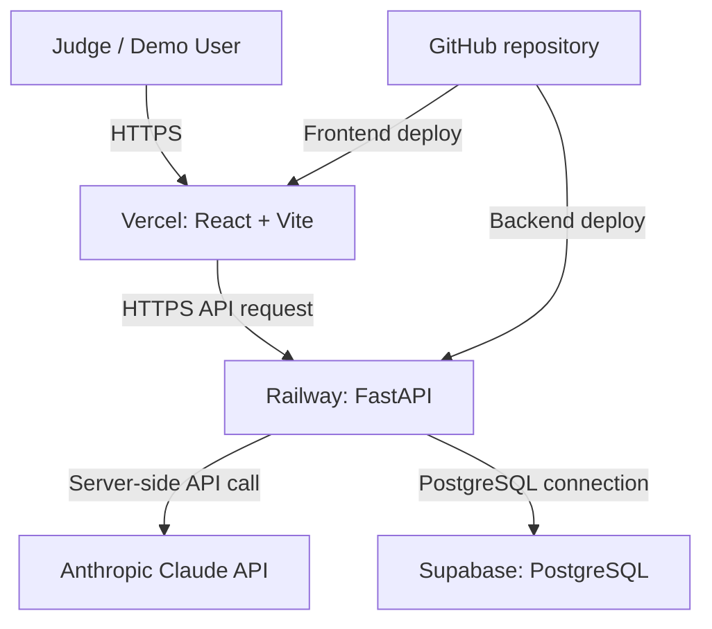

# TraceCare — Project Blueprint & MVP Specification

**Tagline:** Every medical statement, connected to its source.  
**Project type:** Hackathon MVP / evidence-grounded clinical documentation and patient communication assistant  
**Status:** Product and engineering specification for a publicly accessible hackathon demo; not a validated or production clinical product  
**Primary users:** Clinicians and patients (patient-facing output is generated for clinician review / sharing)  
**Initial demo data:** Synthetic or permitted role-played conversations only

---

## 1. Executive summary

TraceCare combines two healthcare workflow ideas:

1. **Evidence-backed clinical documentation:** turn a doctor–patient conversation into a structured draft clinical note. Each statement in the draft links to the exact transcript segment(s) that support it.
2. **Patient-friendly medical explanations:** turn the same verified information into plain language so a patient can better understand what was discussed. Each explanation also links back to the source.
3. **Consultation Coverage Assistant:** when a patient mentions a symptom, compare the conversation with a predefined, clinician-reviewed follow-up checklist for that symptom. Show which areas the clinician explicitly asked about, which information was captured, and which areas were not found or require review.

The product is **not** an AI doctor, diagnostic system, triage tool, or automatic assessment of a clinician's competence. It does not decide whether care was appropriate. Its purpose is to support documentation, transparency, and a clinician's review of the conversation.

### Core product promise

> TraceCare turns a consultation transcript into evidence-linked documentation and a patient-friendly explanation, while showing a transparent, reviewable view of which predefined follow-up topics were covered in the conversation.

### What makes it more than a thin LLM wrapper

The LLM is used for language understanding and rewriting, but the product's core workflow includes application logic that TraceCare owns:

- transcript segmentation and stable source IDs;
- a structured medical-fact schema;
- a versioned, configurable follow-up checklist registry;
- explicit links between transcript segments, extracted facts, checklist items, and generated statements;
- deterministic source/quote/ID validation;
- separate measures for clinician question coverage and information captured;
- review states, overrides, and transparent calculations;
- tests that compare a prompt-only baseline with the TraceCare pipeline.

The LLM proposes structured information. TraceCare's backend validates references, calculates coverage, stores provenance, and controls what may be shown as evidence-linked output.

---

## 2. The problem

### 2.1 Clinician documentation burden

Clinical conversations contain useful details distributed across multiple turns. Writing a concise, structured note after the consultation takes time and creates opportunities for omissions or inaccurate paraphrasing.

### 2.2 Patient understanding

Clinical notes often use terminology that patients may not understand. A plain-language explanation can help patients understand what was recorded, provided that the explanation preserves uncertainty and does not add unsupported medical advice.

### 2.3 Follow-up coverage visibility

A patient may mention a symptom, but the conversation may not establish all of the relevant details that a clinician intended to explore. The clinician may also ask a question that the patient cannot answer. A simple summary does not show this distinction.

TraceCare therefore separates:

- **What the clinician asked**;
- **What information was captured**;
- **What was not found in the transcript**;
- **What needs human review**.

The system must not assume that every checklist item is clinically required for every patient. Checklist content must be configurable and reviewed by qualified clinical advisors before any real-world use.

---

## 3. Product goals and non-goals

### 3.1 MVP goals

1. Accept a pasted or uploaded **text transcript** with speaker labels.
2. Segment the transcript and assign stable segment IDs.
3. Extract atomic, structured facts with exact supporting quotations and source segment IDs.
4. Detect patient-mentioned symptoms and map them only to an existing checklist template from a controlled registry.
5. For each applicable checklist item, assess whether the clinician asked about it and whether related information was captured.
6. Validate source IDs and quotations deterministically in Python.
7. Calculate two transparent percentages:
   - Clinician question coverage.
   - Information capture coverage.
8. Generate a draft clinical note and a patient-friendly explanation from the same structured facts.
9. Make every generated statement clickable so the user can inspect its source evidence.
10. Allow a human reviewer to confirm, correct, or mark checklist items as not applicable / unclear.
11. Run using synthetic sample data even when an API key is not configured, through an explicitly labelled demo provider.
12. Deploy the MVP to a public HTTPS URL so hackathon judges can access it without running the code locally. The public demo must use synthetic / role-played data only.

### 3.2 Out of scope for the hackathon MVP

- Audio recording, transcription, diarisation, or live listening.
- Diagnosis, prognosis, treatment recommendations, medication recommendations, or emergency triage.
- Automated decisions about urgency or access to care.
- Ranking doctors, employee performance scoring, negligence detection, or disciplinary decisions.
- A universal medical checklist or a claim that the checklist represents a standard of care.
- Patient portal integration, EHR integration, or direct write-back to 1177 / another record system.
- Production deployment for real clinical workflows or real patient information. A public hackathon demo deployment using synthetic data is in scope.
- RAG, vector databases, fine-tuning, custom foundation models, or complex multi-agent workflows.
- Automated clinical approval. A clinician must review the draft.

---

## 4. Product terminology and responsible framing

Use these terms in the UI, documentation, and pitch:

- **Consultation Coverage Assistant** — preferred feature name.
- **Clinician question coverage** — percentage of applicable checklist items for which a clinician question was identified in the transcript.
- **Information capture coverage** — percentage of applicable checklist items for which relevant information was captured, whether asked or volunteered.
- **Potential follow-up area** — a checklist item for which no clinician question or sufficient information was found.
- **Needs review** — evidence or classification is uncertain.

Avoid:

- “Doctor accountability score”.
- “Doctor performance score”.
- “Doctor quality percentage”.
- “The doctor missed a medically necessary question”.
- “The consultation was clinically complete”.

A transcript-based percentage is a **conversation coverage indicator**, not a measurement of clinical competence or quality. It is affected by transcript quality, speaker labelling, checklist design, consultation type, and patient circumstances.

---

## 5. Users and main use cases

### 5.1 Clinician

- Reviews a consultation transcript.
- Reviews extracted facts and their source evidence.
- Reviews the generated draft note.
- Sees which predefined follow-up topics were asked, answered, volunteered, not found, or unclear.
- Corrects classifications and marks irrelevant checklist items as not applicable.
- Approves or edits the note outside the MVP's automated process.

### 5.2 Patient

- Receives or views a plain-language explanation of the consultation.
- Can inspect which original statement supports an explanation.
- Is shown uncertainty and missing information rather than receiving invented details.

### 5.3 Hackathon judge / demo user

- Pastes a synthetic transcript.
- Runs the analysis.
- Sees the clinician and patient views.
- Clicks a generated statement to reveal its source.
- Sees the coverage calculations and how a manually corrected item changes the results.

---

## 6. End-to-end user workflow

1. **Create encounter:** The user opens TraceCare and pastes a role-played transcript.
2. **Segment transcript:** The backend normalizes line endings and parses labelled speaker turns. Each turn receives a stable ID such as `S001`, `S002`, etc. The original wording is retained unchanged.
3. **Extract facts:** Claude (or the demo provider) returns structured symptom mentions and medical facts. Every fact must cite one or more existing segment IDs and provide a verbatim quote.
4. **Select checklist template:** The system maps an identified symptom to an existing, versioned template. It must not invent clinical checklist items. If no suitable template exists, the system says that coverage cannot be calculated for that symptom.
5. **Assess each checklist item:** The model identifies possible clinician questions and patient information relevant to each configured item. It returns source segment IDs and quotes. It must distinguish clinician questions from patient statements.
6. **Validate evidence:** Python validates that segment IDs exist, quotes match the referenced text, speakers are plausible, and fact IDs are unique. Semantic assessment remains provisional until reviewed.
7. **Calculate coverage:** Python—not the LLM—calculates the percentages using the formulas in Section 10.
8. **Generate outputs:** A controlled template creates the clinical note; Claude rewrites the same facts into patient-friendly language. Both outputs retain fact IDs.
9. **Review:** The clinician inspects source evidence, changes checklist classifications where needed, and edits the note.
10. **Display:** The frontend shows the draft note, patient explanation, evidence viewer, and consultation coverage panel.

---

## 7. Input and output specifications

### 7.1 MVP input

A plain-text transcript with speaker labels. Example:

```text
Doctor: What brings you here today?
Patient: I've had a headache for three days.
Doctor: Have you had a fever?
Patient: No, I haven't had a fever.
Doctor: Have you taken any medication?
Patient: Yes, but I don't remember the dosage.
Doctor: Have you noticed anything else?
Patient: Sometimes I feel dizzy.
```

The UI must state that the MVP expects a transcript with speaker labels. Do not silently infer speakers when labels are absent. If speaker attribution is ambiguous, flag the transcript for correction.

### 7.2 Transcript segment structure

```json
{
  "segment_id": "S002",
  "speaker": "patient",
  "text": "I've had a headache for three days.",
  "start_char": 34,
  "end_char": 72,
  "turn_index": 2
}
```

Character offsets are calculated by the backend from the original transcript. Do not ask the LLM to invent offsets.

### 7.3 Extracted fact structure

```json
{
  "fact_id": "F001",
  "category": "symptom",
  "concept": "headache",
  "normalized_value": "headache reported",
  "polarity": "positive",
  "certainty": "explicit",
  "temporality": "current",
  "duration": "3 days",
  "frequency": null,
  "source_segment_ids": ["S002"],
  "supporting_quote": "I've had a headache for three days."
}
```

Recommended fields:

- `fact_id` — stable unique ID.
- `category` — symptom, medication, allergy, history, duration, frequency, impact, or other configured category.
- `concept` — normalized concept as a short label.
- `normalized_value` — concise meaning without adding information.
- `polarity` — positive, negative, or uncertain.
- `certainty` — explicit, inferred, or unclear. Inferences must not be presented as confirmed facts.
- `temporality` — current, historical, future/planned, or unclear.
- `duration`, `frequency`, `severity`, `location`, `context` — optional fields only when supported.
- `source_segment_ids` — one or more transcript segment IDs.
- `supporting_quote` — exact text from the source segment(s).

### 7.4 Output A: clinician-facing note

A structured draft with sections such as:

- Reason for consultation / chief concern.
- Symptoms reported.
- Relevant positives and negatives explicitly discussed.
- Medication information mentioned.
- Relevant history mentioned.
- Uncertain or incomplete information.
- Potential follow-up topics not found in the transcript.

The template must not create diagnoses, examination findings, treatment plans, or facts that were not in the transcript. If a section has no evidence, show “Not established in this transcript” rather than inventing content.

### 7.5 Output B: patient-friendly explanation

A plain-language explanation derived from the same accepted facts. It must:

- preserve positive / negative / uncertain meaning;
- preserve temporal context and quantities;
- explain terminology without changing the meaning;
- avoid diagnosis or treatment advice;
- state when something was not established;
- keep links to the same fact IDs used by the clinician note.

The MVP can use English first. Swedish and Arabic can be added only after the core evidence links work correctly.

### 7.6 Output C: consultation coverage report

For each selected symptom template, show:

- checklist item label;
- clinician question status;
- information capture status;
- exact clinician question evidence, if found;
- patient answer / volunteered evidence, if found;
- confidence / review status;
- not-applicable reason, if set by a reviewer.

Show both percentages as fractions, for example `5 / 8 (62.5%)`, not just a large percentage.

---

## 8. Consultation Coverage Assistant — detailed design

This is a differentiating feature, but it must be designed carefully.

### 8.1 What it does

When a patient mentions a symptom, TraceCare selects a matching template from a **predefined clinician-reviewed registry**. The template contains follow-up areas that may be relevant to document for that symptom. TraceCare checks the transcript for evidence that the clinician asked about each area and for evidence that the relevant information was captured.

### 8.2 What it does not do

- It does not determine what a clinician was medically required to ask.
- It does not decide whether a consultation was adequate.
- It does not diagnose or assess patient risk.
- It does not penalize a clinician for a topic that was not relevant or was appropriately not discussed.
- It does not create a checklist from its own medical knowledge at runtime.

### 8.3 Controlled checklist registry

Store checklist templates in code or JSON for the MVP. Each template must include:

- `template_id` and `version`;
- symptom / consultation category;
- display name and description;
- source / clinical reviewer / approval status fields;
- checklist items with stable IDs;
- example phrasings (to help identify questions, not to force exact wording);
- item applicability and whether a reviewer should confirm it.

For the hackathon, include only one or two demonstration templates. Label them **demo templates, not clinical guidelines**. Do not claim they are exhaustive or clinically validated. Have a mentor / qualified clinician review them if available.

Possible generic information dimensions for a headache demonstration template include onset, duration/course, location, description, severity/impact, frequency/pattern, triggers or relieving factors, and other symptoms. These are illustrative documentation dimensions only, not a universal or complete clinical checklist. Any symptom-specific warning-sign questions must be authored and approved by a qualified clinical advisor before being included.

### 8.4 Checklist item status model

Use these statuses:

| Status | Clinician asked? | Information captured? | Meaning |
|---|---:|---:|---|
| `asked_and_addressed` | 1 | 1 | Clinician asked and transcript contains relevant information. |
| `asked_but_unanswered` | 1 | 0 | Clinician asked, but no answer / usable information was found. |
| `volunteered_not_asked` | 0 | 1 | Patient volunteered relevant information, but no clinician question was found. |
| `not_found_in_transcript` | 0 | 0 | No relevant question or information was found. Must be labelled provisional until reviewed. |
| `unclear_needs_review` | pending | pending | Transcript quality, speaker attribution, or semantic mapping is unclear. |
| `not_applicable` | excluded | excluded | A human reviewer marked the item not applicable and provides a reason. |

The system may also store separate fields `clinician_question_segment_ids` and `information_segment_ids` rather than relying only on a single status. This is preferred because the question and answer may occur in different turns.

### 8.5 Two separate metrics

Do not create a single “doctor score”. Calculate two metrics.

Let `N` be the number of applicable, assessable checklist items. Exclude `not_applicable` and `unclear_needs_review` from the denominator, and display the excluded / pending counts separately. A `not_found_in_transcript` item remains in the denominator because it represents a possible gap, but it must be marked provisional until reviewed.

**Clinician question coverage**

```text
(question items with status asked_and_addressed or asked_but_unanswered)
-------------------------------------------------------------------------------- × 100
                 applicable and assessable checklist items (N)
```

**Information capture coverage**

```text
(information items with status asked_and_addressed or volunteered_not_asked)
-------------------------------------------------------------------------------- × 100
                 applicable and assessable checklist items (N)
```

If `N = 0`, display “Coverage not available” rather than dividing by zero.

Example with 8 assessable items:

- 4 asked and addressed;
- 1 asked but unanswered;
- 1 volunteered but not asked;
- 2 not found in transcript.

Then:

- Question coverage = 5 / 8 = 62.5%.
- Information capture = 5 / 8 = 62.5%.

If one patient-volunteered detail is captured, it improves information capture but does not count as a clinician question. If the clinician asks a question and the patient cannot answer, it counts as asked but not as information captured.

### 8.6 Review and correction

The LLM's checklist classifications are **suggestions**, not final truth. The UI must allow a reviewer to:

- confirm the detected question / answer evidence;
- change the status;
- mark an item not applicable and enter a reason;
- mark a result unclear;
- inspect the source segments.

Recalculate metrics after each manual correction on the backend. Record that the result was manually reviewed. For the MVP, a full audit log is optional, but the UI should indicate whether the coverage result is provisional or reviewed.

### 8.7 Wording in the UI

Good:

- “Clinician question coverage: 5 / 8 topics (62.5%).”
- “Information captured: 6 / 8 topics (75%).”
- “2 topics were not found in the transcript; please review.”
- “1 item is pending review due to unclear speaker attribution.”

Avoid:

- “Doctor score: 62.5%.”
- “Doctor failed to ask 3 important questions.”
- “Clinical completeness: 62.5%.”

Always show the checklist template name and version next to the percentage.

---

## 9. LLM responsibilities versus TraceCare-owned logic

### 9.1 LLM responsibilities

The LLM may:

- extract candidate facts from the transcript;
- map patient-mentioned symptoms to an existing template ID from an allowed list;
- identify candidate clinician questions and patient information relevant to checklist items;
- suggest evidence segment IDs and exact supporting quotes;
- rewrite accepted facts into plain language;
- return structured JSON matching the expected schema.

### 9.2 TraceCare backend responsibilities

The backend must:

- parse and segment the transcript;
- assign IDs and character offsets;
- validate JSON with Pydantic;
- check every referenced segment ID exists;
- check every exact quote appears in the referenced segment;
- check source speaker attribution where required;
- reject duplicate / malformed fact IDs;
- prevent generated output from referencing unknown facts;
- calculate both coverage percentages deterministically;
- apply checklist template versioning and applicability rules;
- store evidence links and reviewer decisions;
- mark unsupported / unclear material for review;
- never convert missing information into a negative finding.

### 9.3 Important limitation

A valid quote and source ID prove that the quote exists in the transcript; they do not prove that the clinical interpretation is correct. Semantic interpretation should be displayed as provisional and reviewed by a clinician. Do not label the system “clinically verified” based only on exact-string matching.

### 9.4 Prompt-injection handling

Treat transcript text as untrusted data. A patient or clinician may say something that looks like an instruction to the AI. The extraction prompt must explicitly say that transcript contents are data to analyse, not instructions to follow. The model must never obey instructions embedded in the transcript.

---

## 10. Recommended technical architecture

### 10.1 Stack

**Frontend**

- React + TypeScript + Vite.
- Tailwind CSS for styling (or a similarly simple component library).
- A small API client layer.

**Backend**

- Python 3.11+ (or a compatible current Python version).
- FastAPI.
- Pydantic for request / response validation.
- Local development: SQLite is acceptable for a zero-setup demo.
- Public deployment: use Supabase-hosted PostgreSQL (recommended) or another managed PostgreSQL database. Do not rely on a cloud function or container local filesystem for durable data.
- Use SQLAlchemy with a `DATABASE_URL` configuration so the same repository can use SQLite locally and PostgreSQL when deployed.

**LLM**

- Anthropic Python SDK for Claude API, behind an `LLMProvider` interface.
- Read `ANTHROPIC_API_KEY` from environment variables.
- Read model name from `ANTHROPIC_MODEL`; do not hard-code a model identifier throughout the codebase.
- Use structured JSON output / schema constraints where supported by the chosen model and current API. Still validate all results with Pydantic because schema-constrained output does not validate medical meaning.
- Provide a `DemoLLMProvider` with a clearly labelled synthetic fixture so the app can run and tests can pass without API credits.

Official Anthropic references:

- Python SDK: https://platform.claude.com/docs/en/cli-sdks-libraries/sdks/python
- Messages API: https://platform.claude.com/docs/en/api/messages/create
- Structured outputs: https://platform.claude.com/docs/en/build-with-claude/structured-outputs

**Storage**

- Local development may use SQLite. The deployed demo should use Supabase PostgreSQL for durable encounter records.
- For the simplest deployed schema, store one encounter row with transcript metadata and a validated JSONB analysis result; normalize into more tables only if the implementation genuinely needs it.
- Keep database access in FastAPI. The browser must never receive a database password or service-role secret.
- Do not store real patient data for the hackathon.

### 10.2 High-level data flow

```text
React UI
  |
  | POST transcript + language + selected template(s)
  v
FastAPI
  |
  +--> Transcript parser (our code)
  |
  +--> LLM provider: extract candidate facts / candidate question evidence
  |
  +--> Pydantic schema validation
  |
  +--> Evidence validator (our code)
  |
  +--> Checklist matcher + coverage calculator (our code)
  |
  +--> Clinical note renderer (controlled template)
  |
  +--> LLM patient-language rewriter (using accepted facts only)
  |
  +--> Output reference validator (our code)
  |
  v
Supabase PostgreSQL (deployed) / SQLite (local development) + JSON response
  |
  v
React workspace with evidence panel and review controls
```

### 10.3 Repository structure

```text
tracecare/
├── README.md
├── .gitignore
├── .env.example
├── backend/
│   ├── app/
│   │   ├── main.py
│   │   ├── api/
│   │   │   └── routes.py
│   │   ├── core/
│   │   │   ├── config.py
│   │   │   └── logging.py
│   │   ├── schemas/
│   │   │   ├── transcript.py
│   │   │   ├── facts.py
│   │   │   ├── coverage.py
│   │   │   └── outputs.py
│   │   ├── services/
│   │   │   ├── transcript_parser.py
│   │   │   ├── extraction_service.py
│   │   │   ├── evidence_validator.py
│   │   │   ├── checklist_service.py
│   │   │   ├── coverage_calculator.py
│   │   │   ├── note_generator.py
│   │   │   └── patient_explainer.py
│   │   ├── llm/
│   │   │   ├── base.py
│   │   │   ├── anthropic_provider.py
│   │   │   └── demo_provider.py
│   │   ├── templates/
│   │   │   └── symptom_templates.json
│   │   └── storage/
│   │       ├── database.py
│   │       └── repositories.py
│   ├── tests/
│   ├── requirements.txt
│   └── .env.example
├── frontend/
│   ├── src/
│   │   ├── components/
│   │   ├── pages/
│   │   ├── services/
│   │   ├── types/
│   │   └── App.tsx
│   ├── package.json
│   └── .env.example
├── data/
│   └── README.md
└── docs/
    ├── TRACECARE_PROJECT_BLUEPRINT.md
    ├── CLAUDE_IMPLEMENTATION_PROMPT.md
    └── DEPLOYMENT_GUIDE.md
```

Keep the structure smaller if needed. Do not create empty layers or abstractions that are not used by the MVP.

---

## 11. Suggested API contract

Keep the initial API small. A single synchronous analysis endpoint is sufficient for the hackathon.

### `GET /api/health`

Returns service status.

### `GET /api/templates`

Returns available symptom checklist templates, their IDs, versions, labels, and demo / review status.

### `POST /api/analyze`

Request:

```json
{
  "transcript": "Doctor: ...\nPatient: ...",
  "language": "en",
  "template_ids": ["headache_demo_v1"],
  "provider": "anthropic"
}
```

The `provider` can be omitted and selected from server configuration. Do not allow arbitrary provider or model names from a public user request in production.

Response (illustrative):

```json
{
  "encounter_id": "enc_demo_001",
  "status": "provisional_review_required",
  "segments": [],
  "facts": [],
  "symptoms": [],
  "coverage": {
    "template_id": "headache_demo_v1",
    "template_version": "1.0-demo",
    "question_coverage": {
      "covered": 5,
      "assessable": 8,
      "percentage": 62.5
    },
    "information_capture": {
      "captured": 6,
      "assessable": 8,
      "percentage": 75.0
    },
    "pending_review": 1,
    "not_applicable": 0,
    "is_provisional": true,
    "items": []
  },
  "clinical_note": {
    "statements": []
  },
  "patient_explanation": {
    "statements": []
  },
  "warnings": [
    "Prototype output: clinician review is required.",
    "Coverage percentages describe transcript evidence only, not clinician performance or clinical quality."
  ]
}
```

### `PATCH /api/encounters/{encounter_id}/coverage-items/{item_id}`

Allows a reviewer to change a status, confirm evidence, or mark an item not applicable with a reason. Backend recalculates coverage.

### `GET /api/encounters/{encounter_id}`

Returns the saved analysis and review decisions.

For a one-day MVP, implement `GET /api/health`, `GET /api/templates`, and `POST /api/analyze` first. Implement persistence and review patch only if time permits.

---

## 12. Frontend design

### 12.1 Main page

- TraceCare logo / name and short product description.
- Text area to paste transcript.
- Language selector (English only is acceptable for MVP).
- Template selector showing available demo templates and versions.
- “Analyze consultation” button.
- Sample transcript button to load synthetic data.

### 12.2 Analysis workspace

Use a clear tabbed or split-pane layout:

**Tab A — Clinical note**

- Draft note with sections.
- Evidence badges such as `[F001]` beside statements.
- Clicking a badge opens the evidence panel.
- Prominent “Draft — clinician review required” label.

**Tab B — Patient explanation**

- Plain-language explanation.
- Same fact IDs and source links.
- Notice that the explanation is not a diagnosis or medical advice.

**Tab C — Consultation coverage**

- Two large but neutral metrics: question coverage and information capture.
- Always show numerator / denominator and checklist version.
- A table with each follow-up item, status, clinician question evidence, patient information evidence, and review action.
- Clearly identify “not found in transcript” as provisional until reviewed.
- Display unclear and not-applicable counts.

**Evidence side panel**

- Original speaker and transcript text.
- Highlight exact supporting quote.
- Show segment ID and related fact / checklist item.

### 12.3 UX principles

- Do not use a red “bad doctor” score or rank.
- Neutral statuses; warning styling only for items needing review.
- The user must be able to inspect evidence before trusting an output.
- Do not hide uncertainty in footnotes.
- Use accessible contrast and readable text.

---

## 13. Example checklist template for the MVP

The following is an **illustrative demo template only**, not clinical guidance or a complete standard. It must be reviewed and edited by a qualified clinical advisor before any real-world use.

```json
{
  "template_id": "headache_demo_v1",
  "version": "1.0-demo",
  "display_name": "Headache — consultation documentation demo",
  "status": "demo_not_clinically_validated",
  "review_required": true,
  "items": [
    {"item_id": "onset", "label": "Onset", "example_questions": ["When did it start?", "When did you first notice it?"]},
    {"item_id": "duration_course", "label": "Duration / course", "example_questions": ["How long has it been going on?", "Has it changed over time?"]},
    {"item_id": "location", "label": "Location", "example_questions": ["Where do you feel it?"]},
    {"item_id": "description", "label": "Description", "example_questions": ["How would you describe the feeling?"]},
    {"item_id": "severity_impact", "label": "Severity / impact", "example_questions": ["How severe is it?", "How does it affect your day?"]},
    {"item_id": "frequency_pattern", "label": "Frequency / pattern", "example_questions": ["How often does it happen?"]},
    {"item_id": "triggers_relief", "label": "Triggers / relieving factors", "example_questions": ["Have you noticed what makes it better or worse?"]},
    {"item_id": "other_symptoms", "label": "Other symptoms mentioned", "example_questions": ["Have you noticed anything else?"]}
  ]
}
```

The template is only an example for testing the software mechanics. Do not present its items as mandatory questions, and do not infer that the consultation was incomplete if an item is absent.

---

## 14. Example scoring walkthrough

Assume there are 8 applicable and assessable items:

| Item | Status | Counts as clinician asked? | Counts as information captured? |
|---|---|---:|---:|
| Onset | asked_and_addressed | Yes | Yes |
| Duration / course | asked_and_addressed | Yes | Yes |
| Location | asked_but_unanswered | Yes | No |
| Description | not_found_in_transcript | No | No |
| Severity / impact | not_found_in_transcript | No | No |
| Frequency / pattern | volunteered_not_asked | No | Yes |
| Triggers / relief | not_found_in_transcript | No | No |
| Other symptoms | asked_and_addressed | Yes | Yes |

Question coverage = 4 / 8 = 50%.  
Information capture = 4 / 8 = 50%.

This example illustrates why the two measures must remain separate. If the patient volunteers frequency information, information capture improves, but clinician question coverage does not.

If an item is unclear, place it in a pending-review bucket and do not silently count it as covered or uncovered. Exclude it from the current denominator and display the number pending. When a reviewer resolves it, recalculate the score.

---

## 15. Testing and evaluation

### 15.1 Unit tests

At minimum, test:

1. Transcript parser assigns stable, unique segment IDs.
2. Parser preserves original sentence text.
3. Unknown source segment ID is rejected.
4. Quote absent from the referenced segment is flagged.
5. Speaker mismatch is flagged.
6. Negative statements remain negative.
7. Uncertain statements remain uncertain.
8. Missing information is not converted into a negative finding.
9. Duplicate fact IDs are rejected.
10. Generated statements cannot reference unknown fact IDs.
11. Coverage formulas return correct values.
12. Not-applicable and unclear statuses are handled correctly.
13. Zero assessable items returns “not available”, not a divide-by-zero error.
14. Manual review updates recalculate metrics.

### 15.2 Synthetic demo scenarios

Prepare a small set of synthetic transcripts containing:

- straightforward symptom description;
- explicit denial (for example, “I have not had a fever”);
- uncertain detail (for example, “I don't remember the dosage”);
- a patient-volunteered detail that the clinician did not ask about;
- a clinician question with no usable answer;
- a potential contradiction that needs review;
- a deliberately unsupported fact returned by a test / mocked LLM;
- unclear speaker attribution.

### 15.3 Baseline comparison

To demonstrate the value of TraceCare's own components, run the same synthetic transcripts through:

- **Baseline:** transcript sent directly to an LLM for a note / summary.
- **TraceCare:** structured extraction + source validation + coverage mapping + output reference validation.

Measure:

- percentage of generated statements with valid source references;
- unsupported claim rate in the generated output (reviewed against the synthetic ground truth);
- negation preservation;
- uncertainty preservation;
- symptom follow-up item classification accuracy;
- question coverage calculation correctness;
- information capture calculation correctness.

Do not claim clinical validity from a small hackathon test. Present these as prototype engineering evaluations.

---

## 16. Privacy, security, and safety requirements

- Use only synthetic or explicitly permitted role-played data for the hackathon. Do not upload real patient data.
- Do not include real names, phone numbers, personal identity numbers, addresses, or other direct identifiers in demo transcripts.
- Store API keys only in `.env`; commit `.env.example` with placeholder names, never secrets.
- Add `.env`, database files with data, raw transcripts, and generated datasets to `.gitignore` as appropriate.
- Avoid logging raw transcripts or API payloads. Log encounter IDs and technical errors only.
- Do not send real patient information to an external model in the hackathon prototype.
- Clearly label all outputs as draft / prototype and require clinician review.
- Do not provide diagnosis, triage, treatment, or emergency advice.
- Do not infer that a symptom is absent because it was not mentioned.
- Do not state that a clinician failed to meet a standard of care based on transcript analysis.
- If an item is not found, describe it as “not found in this transcript” and make the status reviewable.
- Any real deployment would require a separate privacy, information-security, clinical-safety, legal, and regulatory assessment, including applicable data-protection obligations. The hackathon MVP is not approved for real patient care.

---

## 17. Hackathon implementation plan

The event prohibits writing application code before the hackathon. This document, architecture planning, README work, and review of permitted datasets are preparation; keep implementation code for the event itself.

### Phase 1 — Minimum vertical slice

- Create a React page with a sample transcript.
- Create FastAPI `POST /api/analyze`.
- Parse transcript into segments.
- Use the DemoLLMProvider to return one known structured response.
- Validate fact references and quotes.
- Render one clinical note with clickable evidence.

**Exit condition:** A user can paste a transcript and click a note statement to reveal the original segment.

### Phase 2 — Claude integration

- Add Anthropic provider behind the provider interface.
- Add `.env.example` and environment configuration.
- Use schema-constrained output where supported and Pydantic validation regardless.
- Handle API errors, timeouts, malformed output, and missing key.

**Exit condition:** Claude can return facts in the required schema, and the app validates them.

### Phase 3 — Patient explanation

- Generate an explanation from accepted facts only.
- Validate every generated statement's fact IDs.
- Render the patient tab with source links.

**Exit condition:** Both outputs refer to the same fact IDs and source segments.

### Phase 4 — Coverage assistant

- Add one demo symptom template.
- Detect the symptom mention and ask the LLM to map the transcript to that template's items.
- Validate source references.
- Calculate question coverage and information capture separately.
- Show provisional / pending review states.

**Exit condition:** A judge can see 2 separate percentages, inspect the item breakdown, and correct one status.

### Phase 5 — Polish and demo

- Test negation, uncertainty, volunteered facts, unanswered questions and unsupported claims.
- Improve visual hierarchy and evidence highlighting.
- Prepare a 3–5 minute demonstration.

If time becomes limited, prioritize the minimum vertical slice, then the patient explanation, then coverage metrics. Do not sacrifice evidence traceability for extra features.

### Phase 6 — Public demo deployment

- Deploy the React frontend to Vercel.
- Deploy the FastAPI backend to Railway (recommended) or Render. Vercel Python Functions are an alternative if the team prefers to host FastAPI on Vercel and accepts the Python runtime being documented as Beta.
- Create a Supabase PostgreSQL project and configure the backend `DATABASE_URL`.
- Set `VITE_API_BASE_URL` on Vercel and restrict backend CORS to the exact production frontend URL.
- Add all secrets in the hosting providers’ environment-variable dashboards.
- Verify `GET /api/health`, `GET /api/templates`, and a synthetic `POST /api/analyze` against the deployed URLs.
- Confirm the deployed app loads after refresh and that encounter persistence (if enabled) works.
- Add the public demo URL to the root README.

**Exit condition:** A judge can open the HTTPS frontend URL, run a synthetic transcript analysis, inspect evidence links and coverage metrics, and complete the demo without running anything locally.

---

## 18. Suggested pitch

**One-sentence pitch**

TraceCare transforms doctor–patient conversations into evidence-linked clinical notes and understandable patient explanations, while showing a transparent view of which predefined follow-up topics were asked about and which information was captured.

**Problem**

Clinicians must document conversations accurately, patients often struggle to understand medical language, and a generated summary alone does not show whether important discussion points were explored or where each statement came from.

**Solution**

TraceCare extracts structured facts, connects them to original transcript evidence, produces two tailored outputs, and calculates transparent consultation coverage indicators from configurable clinician-reviewed templates.

**Differentiator**

TraceCare does not simply generate a summary. It preserves provenance, validates source references, distinguishes clinician questions from patient-volunteered information, and exposes uncertainty for human review.

**Initial customer hypothesis**

Clinics and healthcare organizations that want to explore documentation support and clearer patient communication. This is a hypothesis to validate with clinicians and potential buyers, not an established market result.

---

## 19. Decisions to keep fixed during the hackathon

1. Start with text transcript only.
2. Use one LLM provider (Claude) plus a demo provider for tests.
3. Use one small, explicitly labelled demo checklist template first.
4. Calculate scores in backend Python, never in the LLM.
5. Keep question coverage and information capture separate.
6. Never label the percentage as doctor performance or clinical quality.
7. Every fact and generated statement must preserve its source IDs.
8. Use synthetic / permitted role-played data only.
9. Do not introduce RAG, audio, model training, or complex infrastructure until the MVP works.
10. The clinician remains responsible for reviewing and approving any clinical note.

**Definition of done:** A user can open the public HTTPS demo URL, paste or load a synthetic transcript, receive an evidence-linked draft clinical note and patient explanation, inspect the original source for each generated statement, and see two transparent, reviewable coverage percentages with an item-by-item breakdown. The deployed app passes its health check and does not expose secrets or accept real patient data.


## 20. Public MVP deployment architecture

The hackathon MVP must be accessible through a public HTTPS URL. This is a **demo deployment**, not a production healthcare service. It must use synthetic or permitted role-played conversations only.

### 20.1 Recommended hosting arrangement

**Recommended default:**

- **GitHub:** source control and deployment trigger.
- **Vercel:** React + Vite frontend.
- **Railway:** Python + FastAPI backend.
- **Supabase:** managed PostgreSQL database.
- **Anthropic:** Claude API called only from the FastAPI backend.



This keeps the current React + FastAPI architecture intact. Supabase is the managed database, not a replacement for FastAPI: FastAPI continues to own transcript processing, LLM orchestration, evidence validation, coverage calculations, and output generation.

Why this is the preferred arrangement:

- Vercel provides a straightforward Git-connected deployment for the Vite frontend.
- Railway documents direct deployment of FastAPI from a GitHub repository and lets the user generate a public service domain.
- Supabase provides a managed PostgreSQL database and lets the team select the hosting region.
- The frontend, API, database, and model credentials have clear responsibilities.

Official setup references:

- Vercel monorepo / root directory setup: https://vercel.com/docs/monorepos
- Railway FastAPI deployment: https://railway.com/guides/fastapi
- Supabase database overview: https://supabase.com/docs/guides/database/overview
- Supabase region and data residency FAQ: https://supabase.com/legal/privacy-resources/data-residency-transfers-faq

### 20.2 Hosting alternatives

| Option | Advantages | Trade-offs | Recommendation |
|---|---|---|---|
| Vercel frontend + Railway FastAPI + Supabase Postgres | Keeps React and Python stack; simple GitHub-to-deploy flow; separate services | Check Railway trial/usage conditions; services on its Free plan sleep when idle | **Recommended default** if the team is comfortable with Railway's current trial/usage model |
| Vercel frontend + Render FastAPI + Supabase Postgres | Straightforward Python web-service deployment; familiar dashboard | Render Free web services sleep after 15 minutes idle and may take about a minute to wake; free filesystem is ephemeral | Good for testing; use a paid always-on instance if the live demo must respond immediately |
| Vercel frontend + Vercel Python/FastAPI + Supabase Postgres | Fewer hosting vendors; Vercel supports Python including FastAPI | Python runtime is documented as Beta; function duration limits apply; test the actual API workflow before relying on it | Good alternative if the team wants to keep everything on Vercel and verifies compatibility early |
| Vercel frontend + Supabase Edge Functions + Supabase Postgres | Can reduce the number of hosted backend services | Edge Functions are TypeScript/Deno-oriented; would require reworking the Python/FastAPI pipeline | Not recommended for the current project architecture |

Current platform notes (re-check before deployment because plans and limits can change):

- Vercel's Python runtime documentation labels the runtime Beta. Its Functions documentation lists a 300-second maximum for Hobby with Fluid Compute; confirm current plan and configuration before deployment: https://vercel.com/docs/functions/runtimes/python and https://vercel.com/docs/functions/limitations.
- Render Free web services spin down after 15 minutes without inbound traffic; the next request can take about a minute to wake. Their local filesystem is ephemeral: https://render.com/docs/free.
- Railway's current Free plan includes $1 of monthly usage and sleeps services after 5–10 minutes of outbound inactivity. New accounts may receive a one-time trial grant; check the current billing page before relying on it: https://docs.railway.com/pricing/free-plan and https://docs.railway.com/pricing/plans. The trial may have network restrictions depending on account verification; confirm outbound access to Anthropic before using it for the demo.

Do not choose a host based only on the word “free”. Test the actual end-to-end workflow and verify the account's current plan, trial, usage cap, sleep behaviour, and any payment-card requirement.

### 20.3 Frontend deployment on Vercel

1. Push the repository to GitHub.
2. In Vercel, import the repository.
3. Set the Vercel project's **Root Directory** to `frontend`.
4. Use the Vite build command, normally `npm run build`, and output directory `dist` (unless the actual frontend framework changes).
5. Add `VITE_API_BASE_URL` pointing to the deployed FastAPI base URL, e.g. `https://<your-api-domain>`.
6. Deploy and copy the HTTPS frontend URL.
7. Add the exact frontend URL to backend `CORS_ORIGINS`.

For a monorepo, Vercel supports configuring a separate project root directory for each project. If the team later chooses to host the Python API on Vercel too, create a separate Vercel project rooted at `backend`, and confirm the FastAPI entrypoint/runtime configuration using the current Vercel Python documentation.

### 20.4 Backend deployment on Railway (recommended default)

1. Create a Railway project and connect the GitHub repository.
2. Create a service from the repository and set its **Root Directory** to `backend`.
3. Build command: `pip install -r requirements.txt` (or use Railway's detected Python build if it works reliably).
4. Start command: `uvicorn app.main:app --host 0.0.0.0 --port $PORT` (adjust the module path only if the implemented repository differs).
5. Generate a public domain in the Railway service's Networking settings.
6. Add backend environment variables in Railway's Variables panel; never commit them.
7. Verify `GET /api/health` using the generated API URL.

If using Render instead, create a Python Web Service with root directory `backend`, build command `pip install -r requirements.txt`, and start command `uvicorn app.main:app --host 0.0.0.0 --port $PORT`. Configure an HTTP health check at `/api/health` if available on the selected service plan.

### 20.5 Supabase database setup

Use Supabase for **PostgreSQL persistence**, not as a replacement for the FastAPI business-logic layer.

1. Create a Supabase project.
2. Select an EU region if available and appropriate for the demo audience. The Supabase project region determines where the database, Auth, and Storage are hosted; region selection by itself does not make the application GDPR-compliant.
3. Create the initial schema through a checked-in SQL migration, for example `supabase/migrations/001_initial_schema.sql`.
4. Configure the FastAPI backend to read a server-side `DATABASE_URL` from its environment.
5. Use the Supabase connection string / pooler mode appropriate to the backend host. For serverless functions, Supabase documents using the transaction pooler for Postgres client connections; for a long-running API service, choose the connection mode and pool size based on its connection behaviour.
6. Keep database credentials exclusively in the backend environment. Never expose the database password or `service_role` key in browser code.
7. If any table is exposed through Supabase's Data API, enable and test Row Level Security (RLS), and grant only the operations that are needed. Prefer keeping all encounter access behind FastAPI for this MVP.

Suggested minimal `encounters` table for the deployed demo:

- `id` UUID primary key;
- `created_at` timestamp with time zone;
- `language` text;
- `template_id` and `template_version` text;
- `provider` text (`demo` or `anthropic`);
- `transcript_text` text (synthetic / permitted role-play only);
- `analysis_result` JSONB (segments, facts, evidence references, coverage, and generated outputs);
- `review_status` text.

Keep the first deployed database schema small. A single encounter row with a JSONB analysis result is adequate for a hackathon demo. Normalize into separate tables only if a concrete feature needs it. Add a delete-encounter path or a documented cleanup procedure. Do not store real patient information.

Official references:

- Supabase PostgreSQL and connection overview: https://supabase.com/docs/guides/database/overview
- Supabase RLS: https://supabase.com/docs/guides/database/postgres/row-level-security
- Supabase serverless database connections: https://supabase.com/docs/guides/database/connecting-to-postgres/serverless-drivers

### 20.6 Required environment variables

Use `.env.example` to document names and safe placeholders only. Use the hosting dashboards to configure real values.

**Backend (Railway / Render / Vercel Python Function):**

| Variable | Purpose |
|---|---|
| `APP_ENV` | `development` or `production` |
| `ANTHROPIC_API_KEY` | Claude API secret; backend only |
| `ANTHROPIC_MODEL` | Model identifier from configuration |
| `DATABASE_URL` | Supabase PostgreSQL connection string; local SQLite URL for local development if needed |
| `CORS_ORIGINS` | Comma-separated exact allowed frontend origins |
| `DEMO_MODE_ENABLED` | Whether deterministic synthetic demo mode is available |
| `DEMO_ACCESS_PASSWORD` | Optional shared demo gate; backend only |
| `MAX_TRANSCRIPT_CHARS` | Maximum accepted transcript size |
| `ANALYSIS_RATE_LIMIT` | Per-client analysis limit / configuration |

**Frontend (Vercel):**

| Variable | Purpose |
|---|---|
| `VITE_API_BASE_URL` | Public base URL of FastAPI. This is not a secret. |

Never name a frontend variable `VITE_ANTHROPIC_API_KEY`, `VITE_DATABASE_URL`, or `VITE_SUPABASE_SERVICE_ROLE_KEY`. Vite exposes `VITE_` variables to the browser bundle.

### 20.7 Public demo security and cost controls

- Deploy only synthetic / role-played sample data. Public reachability does not authorize real patient-data processing.
- Keep Claude API calls server-side. Do not call Anthropic directly from React.
- Put an input-size limit on `/api/analyze` and reject oversized transcripts before the model call.
- Add simple server-side rate limiting or a shared demo access gate to protect API spend. A client-side disabled button is not a security control.
- If a shared demo password is used, validate it on the backend and issue a short-lived signed session; do not treat a password hard-coded into the frontend as secret.
- Use request timeouts and handle model-provider failures gracefully. Retain the deterministic demo provider so the product can still be demonstrated if the Claude API is unavailable.
- Set a modest per-analysis token / output limit and check Anthropic usage separately from Claude Code subscription or credits.
- Restrict CORS to the Vercel production origin and `localhost` development origin. Do not use `*` with credentials.
- Do not log transcript bodies, model prompts containing transcript text, API keys, or database connection strings.
- Keep production and preview environment variables separate. Use a separate Supabase project or isolated schema for experiments if the team creates preview deployments.
- Do not add public user accounts for the hackathon unless a concrete need appears. Authentication adds scope; a protected demo gate is enough for a small judge demo.

### 20.8 Continuous deployment and URLs

- `main` is the deploy branch for the public demo.
- Feature branches / pull requests use preview deployments where available.
- Vercel automatically provides a deployment URL; Railway provides a service domain after one is generated; Render provides an `onrender.com` URL.
- Add `PUBLIC_DEMO_URL` and `PUBLIC_API_URL` to the root README after the first successful deploy.
- Do not hard-code provider hostnames into source code; use `VITE_API_BASE_URL` and backend `CORS_ORIGINS`.

### 20.9 Deployment acceptance checklist

- [ ] Frontend opens from a public HTTPS URL in a private/incognito browser window.
- [ ] Frontend can reach the deployed FastAPI API.
- [ ] `GET /api/health` returns success.
- [ ] `GET /api/templates` returns the available demo template.
- [ ] `POST /api/analyze` works with a synthetic transcript using the demo provider.
- [ ] Claude provider works when the server-side key is configured, or the UI clearly indicates that demo mode is being used.
- [ ] Evidence links resolve to the exact original transcript segments.
- [ ] Both coverage metrics show numerator, denominator, percentage, and pending / excluded counts.
- [ ] Refreshing the browser does not break the current result; if persistence is implemented, the saved demo encounter can be reloaded.
- [ ] No secrets appear in frontend source, browser devtools, Git history, or logs.
- [ ] CORS permits only intended origins.
- [ ] The app clearly states that it is a synthetic-data hackathon prototype and not for real patient data or clinical decisions.
- [ ] README contains the public demo URL and basic usage instructions.

**Final rule:** the publicly deployed version is a demonstration environment only. Do not use it for real consultations, real patient identifiers, clinical decisions, or production healthcare operations.
